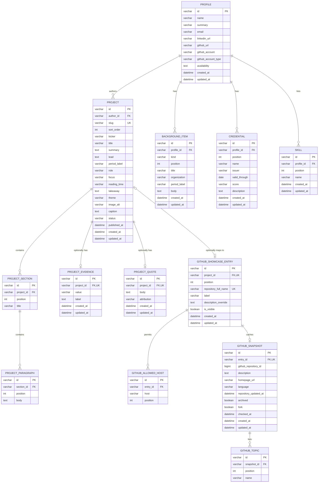

# MySQL + Prisma Database Plan

**Status:** Implemented with a CLI seed workflow  
**Created:** 2026-11-05  
**Project:** `nyxxyr-project-showcase`  
**Target stack:** MySQL 8, Prisma ORM, Next.js 16

## 1. Objective

Move the portfolio's authored content from TypeScript and JSON files into
MySQL while preserving the existing page structure, project routes, visual
design, and GitHub fallback behavior.

The database should become the source of truth for:

- Profile, contact, skills, background, education, and credentials.
- Published and draft project stories.
- Ordered project sections, paragraphs, evidence, and optional quotes.
- Curated GitHub showcase entries and their last-known-good snapshots.

Site navigation, visual styling, copy that belongs to the interface, and Next.js
cache configuration should remain in code.

## 2. Schema principles

- Keep one public profile per deployment, while using normal foreign keys so
  the model does not depend on a hidden singleton.
- Keep project ordering explicit with integer positions.
- Store authored text as plain text, not HTML or Markdown. Render it as text so
  database content cannot inject markup.
- Do not invent project dates, roles, quotes, or proficiency levels. Missing
  fields remain nullable.
- Keep GitHub metadata as a cache/snapshot. The allowlist and editorial
  overrides are authored content; repository name, language, topics, and update
  date still come from GitHub.
- Use `utf8mb4` so project text can contain the full Unicode range.
- Prefer hard deletes with `onDelete: Cascade` initially. Add soft deletion only
  if a future admin workflow needs undo or audit history.

## 3. Entity relationship diagram



## 4. Prisma model decisions

Use Prisma model names in PascalCase with explicit table names:

| Prisma model | Suggested MySQL table |
| --- | --- |
| `Profile` | `profiles` |
| `Project` | `projects` |
| `ProjectSection` | `project_sections` |
| `ProjectParagraph` | `project_paragraphs` |
| `ProjectEvidence` | `project_evidence` |
| `ProjectQuote` | `project_quotes` |
| `BackgroundItem` | `background_items` |
| `Credential` | `credentials` |
| `Skill` | `skills` |
| `GithubShowcaseEntry` | `github_showcase_entries` |
| `GithubAllowedHost` | `github_allowed_hosts` |
| `GithubSnapshot` | `github_snapshots` |
| `GithubTopic` | `github_topics` |

Recommended enums and defaults:

```prisma
enum ProjectStatus {
  DRAFT
  PUBLISHED
  ARCHIVED
}

enum ProjectTheme {
  CIVIC
  ENGINEERING
  EDUCATION
}

enum BackgroundKind {
  EXPERIENCE
  EDUCATION
}

enum GithubAccountType {
  USER
  ORGANIZATION
}
```

Use `String @id @default(cuid())` with `@db.VarChar(191)` for identifiers.
Use `@db.VarChar(...)` for bounded fields and `@db.Text` for summaries,
paragraphs, descriptions, and other editorial prose.

Important constraints and indexes:

- `Project.slug` is unique.
- `Project.authorId` references `Profile`.
- `@@unique([authorId, sortOrder])` prevents ambiguous project ordering.
- `ProjectSection` uses `@@unique([projectId, position])`.
- `ProjectParagraph` uses `@@unique([sectionId, position])`.
- `ProjectEvidence.projectId` and `ProjectQuote.projectId` are unique.
- Background items and skills use `@@unique([profileId, position])`.
- `GithubShowcaseEntry.repositoryFullName` is unique and stored in lowercase.
- `GithubShowcaseEntry.projectId` is nullable and unique when present.
- `GithubAllowedHost` uses `@@unique([entryId, host])`.
- `GithubSnapshot.entryId` is unique.
- `GithubTopic` uses `@@unique([snapshotId, position])`.
- Add an index on `Project.status` and `Project.sortOrder` for public queries.

All child relations should cascade when their parent is deleted. A project
relation from `GithubShowcaseEntry` should use `onDelete: SetNull` so deleting a
story does not delete the repository curation record; the relation itself is
nullable.

## 5. Content mapping

### Existing profile

`lib/profile.ts` maps to one `Profile` row plus ordered rows in
`BackgroundItem` and `Skill`.

- The first two background cards become `BackgroundKind.EXPERIENCE`.
- The education card becomes `BackgroundKind.EDUCATION`.
- BNSP, Sanbercode, and Google IT Support details can remain in the education
  card body initially or move into `Credential` rows.
- Store `githubAccountType` on `Profile`; the current account type is `USER`.
- Do not add a phone field unless its publication is explicitly approved.

### Existing projects

`lib/projects.ts` maps to:

- One `Project` row per project.
- One `ProjectEvidence` row when `evidence` exists.
- `story.lead` as `Project.lead`.
- Each story section to one `ProjectSection` and one or more
  `ProjectParagraph` rows.
- `story.quote` to `ProjectQuote` only when an approved quote exists.
- `theme` to `ProjectTheme`.
- Existing optional fields to nullable columns.

The displayed project number can be derived from `sortOrder` with two-digit
padding. A separate `indexLabel` column is unnecessary unless editorial numbers
must intentionally diverge from publication order.

### Existing GitHub showcase

`data/github-showcase.ts` maps to ordered `GithubShowcaseEntry` and
`GithubAllowedHost` rows. `data/github-showcase-fallback.json` maps to
`GithubSnapshot` and `GithubTopic` rows.

GitHub should remain a server-side live integration. A successful request
updates the snapshot transactionally; a failed request reads the latest stored
snapshot. Never place a GitHub token in the database or expose it to the
browser.

## 6. Suggested Prisma shape

The implementation can follow this outline; this is not the complete generated
schema:

```prisma
model Profile {
  id                String            @id @default(cuid()) @db.VarChar(191)
  name              String            @db.VarChar(120)
  summary           String            @db.VarChar(255)
  email             String            @db.VarChar(254)
  linkedInUrl       String            @map("linkedin_url") @db.VarChar(500)
  githubUrl         String            @map("github_url") @db.VarChar(500)
  githubAccount     String?           @map("github_account") @db.VarChar(39)
  githubAccountType GithubAccountType @default(USER) @map("github_account_type")
  availability      String?           @db.Text
  projects          Project[]
  backgroundItems   BackgroundItem[]
  credentials       Credential[]
  skills            Skill[]

  @@map("profiles")
}

model Project {
  id           String          @id @default(cuid()) @db.VarChar(191)
  authorId     String          @map("author_id") @db.VarChar(191)
  slug         String          @unique @db.VarChar(191)
  sortOrder    Int             @map("sort_order")
  kicker       String          @db.VarChar(191)
  title        String          @db.VarChar(255)
  summary      String          @db.Text
  lead         String          @db.Text
  periodLabel  String?         @map("period_label") @db.VarChar(120)
  role         String?         @db.VarChar(191)
  focus        String          @db.VarChar(255)
  readingTime  String          @map("reading_time") @db.VarChar(64)
  takeaway     String          @db.Text
  theme        ProjectTheme
  imageAlt     String          @map("image_alt") @db.Text
  caption      String          @db.Text
  status       ProjectStatus   @default(DRAFT)
  publishedAt  DateTime?       @map("published_at")
  createdAt    DateTime        @default(now()) @map("created_at")
  updatedAt    DateTime        @updatedAt @map("updated_at")
  author       Profile         @relation(fields: [authorId], references: [id])
  sections     ProjectSection[]
  evidence     ProjectEvidence?
  quote        ProjectQuote?
  githubEntry  GithubShowcaseEntry?

  @@unique([authorId, sortOrder])
  @@index([status, sortOrder])
  @@map("projects")
}
```

Use the same naming pattern for the remaining models. A seed script should
import the current TypeScript and JSON content once inside a transaction,
rather than keeping two live sources after the cutover.

## 7. Data access and Next.js integration

1. Add `prisma`, `@prisma/client`, and the datasource configuration.
2. Create `lib/db.ts` with one Prisma client for development hot reloads.
3. Create server-only query modules, such as `lib/queries/projects.ts` and
   `lib/queries/profile.ts`, that return the existing UI-shaped types.
4. Load projects with their ordered sections, paragraphs, evidence, quote, and
   optional GitHub entry in one bounded query.
5. Keep the current components and design; change data acquisition rather than
   component markup.
6. Mark shared reads with explicit cache tags, such as `portfolio-projects`,
   `portfolio-profile`, and `github-showcase`.
7. Invalidate the relevant tags after content mutations.
8. Build `generateStaticParams()` from published project slugs or verify the
   chosen Cache Components behavior before replacing the current static source.
9. Do not query Prisma from Client Components. Keep database access in Server
   Components, server actions, or route handlers.

Recommended public query filters:

```text
Project.status = PUBLISHED
Project.publishedAt is null or <= now
Project.authorId = active profile id
```

Draft and archived projects must never appear in sitemap, metadata discovery,
next-project navigation, or static parameter generation.

## 8. Migration sequence

1. Decide how content will be edited: a minimal protected admin area, a CLI
   seed workflow, or an external headless CMS. Authentication is not included
   in this first schema because that choice changes the user/session tables.
2. Provision MySQL 8 with a dedicated application user. Use a TLS connection in
   production and store only the URL in `DATABASE_URL`.
3. Add the Prisma schema and run the initial migration.
4. Write an idempotent seed that imports `lib/profile.ts`, `lib/projects.ts`,
   `data/github-showcase.ts`, and the fallback JSON.
5. Compare seeded records against the current rendered pages before switching
   reads.
6. Switch profile and project reads to Prisma behind the existing output
   contracts.
7. Switch GitHub curation and snapshot storage to Prisma while retaining the
   live API adapter and failure handling.
8. Run focused checks for draft visibility, ordering, missing optional fields,
   next-project navigation, metadata, and fallback behavior.
9. Remove or archive the static data modules only after the database is verified
   in production. Keep a database backup before removing the old source.
10. Document backup, restore, migration, and content-update procedures.

## 9. Verification checklist

- The seeded site renders the same three projects and profile content as the
  static version.
- Project sections and paragraphs appear in their configured order.
- Draft, archived, and future-published projects do not leak into public pages.
- Optional period, role, evidence, and quote fields omit cleanly.
- Slugs remain stable so existing `/work/[slug]` URLs do not break.
- GitHub allowlist order, overrides, topic order, and approved homepage hosts
  match the current integration.
- GitHub API failure reads the latest snapshot without exposing tokens or raw
  responses.
- Database content is rendered as text; no user-supplied HTML is executed.
- `npm run lint` and `npm run build` pass.
- A MySQL restore into an empty database succeeds.

## 10. Open decisions

Initial implementation choices: content is managed through the idempotent CLI
seed until an authenticated admin exists; credentials are separate records;
project dates remain editorial `periodLabel` text; and GitHub snapshots are
stored in MySQL.

1. Will content be edited through an admin UI, a CLI, or another CMS?
2. Should credentials be separate records or remain part of the education
   background card?
3. Should project dates become structured `startDate`/`endDate` fields, or stay
   as editorial `periodLabel` text?
4. Should GitHub snapshots be stored in MySQL or remain in a version-controlled
   JSON fallback?

Recommended initial choices are a protected admin UI or authenticated server
actions later, separate credential records, `periodLabel` until exact dates are
approved, and database-backed GitHub snapshots for consistent operational
tooling.
